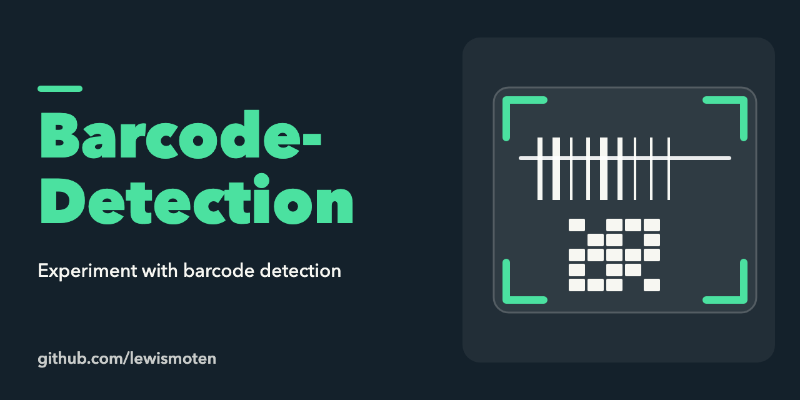

# Barcode Detection

An experiment with detecting barcodes and QR codes from a camera in the browser. It includes a `BarcodeDetector` polyfill and uses OpenCV.js to find and straighten the code in the video frame.

Live demo: <https://lewismoten.github.io/Barcode-Detection/>

# Local Dev

You'll need to run Run a web server in the local directory with a signed certificate. Here is an example for PHP.

Create a self-signed certificate

```bash
openssl req -x509 -out localhost.crt -keyout localhost.key \
-newkey rsa:2048 -nodes -sha256 \
-subj '/CN=localhost' -extensions EXT -config <( \
	printf "[dn]\nCN=localhost\n[req]\ndistinguished_name = dn\n[EXT]\nsubjectAltName=DNS:localhost\nkeyUsage=digitalSignature\nextendedKeyUsage=serverAuth")
```

Host the web server with SSL

```bash
node ./server.js
```

Open your browser and go to https://localhost:8000
